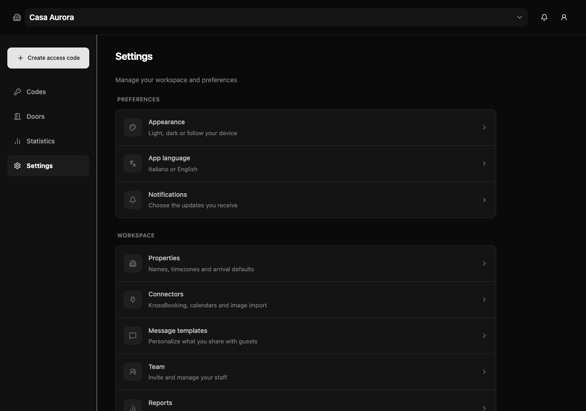
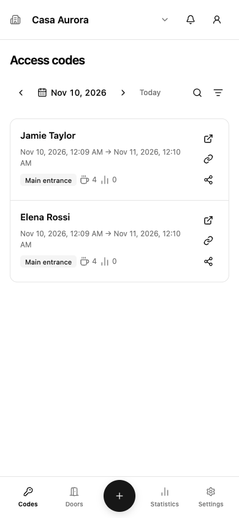
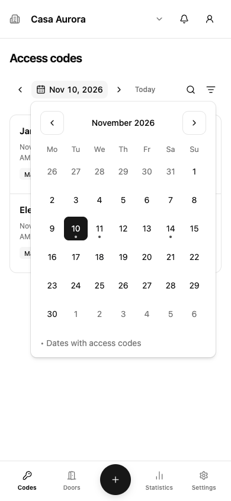
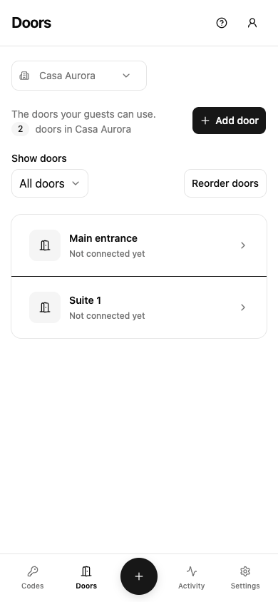
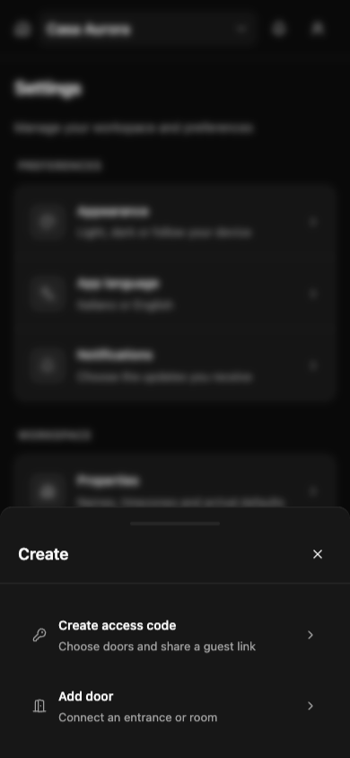

# oshost

**Welcome your guests. Share a link. Keep control of your doors.**

oshost is a self-hosted guest access app for B&Bs, guesthouses, and small hospitality teams. Create an access code, choose the doors and times it allows, and share a guest link. Your guests open it in their browser, with no account to create.

One Docker container serves the host app, guest app, and a public breakfast counter. Your access records, shared notification history, and saved connections stay on your server.

[Get started](#get-started) · [How it works](#how-it-works) · [Documentation](#documentation)



## On your phone

<p>
  
  
  
  
</p>

## A workspace for you. A simple welcome for guests.

- **Create access codes in seconds.** Give each guest the doors they need, with separate dates and single-use rules for each door. Copy a link or prepare a welcome message in Italian or English.
- **Manage your places together.** Switch structures from the header, organize doors, invite staff, and test device connections. The bell opens shared notification history; the statistics tab shows usage reports.
- **Keep breakfast simple.** Give a code its own allowance. Guests redeem from their page; your breakfast team sees how many breakfasts were actually used, without guest details. Settings lets you open the page or protect it with a password.
- **Start manually, add helpers later.** KrossBooking, iCal calendars, and optional Gemini screenshot reading can fill in a draft. You review it before creating a code.
- **Use it like an app.** Install separate host and guest web apps. Choose a light or dark theme and enable host notifications for access and breakfast activity. Browse codes in a calendar with marked dates, and drag doors into order on your phone.

The host app supports **Italian and English**. The guest app supports **Italian, English, French, Spanish, and German**.

## How it works

1. **Add your property.** Set its timezone and arrival defaults. The interactive tour helps you create your first property, example door, and access code. You can skip it at any time.
2. **Connect your doors.** Use eWeLink webhooks or Shelly Cloud. You can create an example door first and connect the device later.
3. **Create and share an access code.** Pick its doors, set their validity, add breakfast if needed, and send the guest link through whichever messaging app you use.
4. **Welcome your guests.** Their page shows available doors and breakfast. You can edit or revoke access and review activity from the host app.

Booking and calendar imports prepare a draft for you to check before saving.

## Get started

You need a server with Docker, a persistent data volume, and an HTTPS address. Images are available for **AMD64 and ARM64** on [Docker Hub](https://hub.docker.com/r/alexmatter/oshost).

### With Portainer

1. Open **Stacks → Add stack → Web editor** and paste [compose.yaml](compose.yaml).
2. Change `ORIGIN` to your public address, for example `https://stay.example.com`, and `VAPID_SUBJECT` to your contact address, for example `mailto:you@example.com`.
3. Deploy the stack and point your HTTPS reverse proxy at the app.
4. Open the container's **Logs** and copy the `setupToken` from the `setup.required` entry.
5. Visit **`https://stay.example.com/host/`**, create the owner account, and follow the tour.

The app generates its setup token and encryption keys on first startup. There is no `.env` file to prepare for the stack, and no separate database server to install.

The Compose file publishes **`127.0.0.1:38471`** for a reverse proxy running on the server. A proxy on the same Docker network can instead use **`oshost:3000`**. HTTPS enables web app installation and notifications on phones. See the [reverse proxy examples](docs/REFERENCE.md#docker--portainer) for more detail.

### With Docker Compose

Save [compose.yaml](compose.yaml), edit the two configuration values above, then run:

```sh
docker compose up -d
docker compose logs oshost
```

Copy the setup token from the logs and create your owner account at `/host/`.

## Install it on your phone

The onboarding tour walks you through installation and notification access. **Settings → Install app** keeps the iOS and Android instructions available later.

- **Android and desktop:** use the install action when your browser offers it, or the browser's install menu.
- **iPhone and iPad:** open the app in Safari, choose **Share → Add to Home Screen**, then open the installed app to enable notifications.

You can keep using the app if you skip installation or notifications. Door opening and breakfast redemption require an internet connection to your server; unfinished host forms stay on your device.

## Bring in details from a calendar or booking

**KrossBooking:** connect your account, complete verification, find the reservation, and review the suggested code. The bearer token is encrypted in the server’s SQLite database and shared across the team’s devices. The browser never stores or receives it; your Kross password is not saved.

**iCal:** upload a calendar or fetch a saved calendar URL, inspect its events, then choose the door those events belong to. For example, a calendar for “Room 2” maps to the Room 2 door. In the draft, you can add the main entrance or other doors before saving. Importing a calendar alone creates no access codes.

**AI:** optionally connect a Gemini API key and extract guest details from a screenshot. KrossBooking, iCal and AI each show source details, mapped doors, dates and links before you choose **Use details in access code**. You still review and save the final form yourself.

All connectors are optional. You can create your first access code without configuring any of them. Set reusable check-in and instructions links under **Settings → Guest links** for each structure. New forms use those defaults; reservation-specific links from a connector take priority. New breakfast allowances start the day after arrival by default, with editable dates.

## Notification history and push

The host bell includes a personal unread badge. Opening history marks its loaded
notifications read across your devices; teammates keep their own read status.
You can also mark the selected structure's history as read at once.

The bell shows the selected structure’s history for everyone on your team. Notifications are kept for **three months** by default. Change that period under **Settings → Notifications**; older entries are automatically deleted. Statistics are preserved independently.

While the host app is open, notifications, access-code lists, and usage counts update over an authenticated WebSocket. Lists animate additions and changes, respecting reduced-motion preferences. Access-code creation can notify the team with the creator, code name, and validity dates. Save in-app preferences without enabling browser push.

Push notifications are optional. Each device chooses the structures and event types it receives. History and push messages support Italian and English and include the access-code name when available. You can also receive alerts for invalid guest links, including attempts to load the guest page. Invalid-link alerts are grouped per client and bounded globally; suppressed attempts are summarized on the next invalid request after each one-minute window. Changing push filters does not hide or delete the shared history.

Guest links keep their access code in the address, including when guests change pages or language. The token is never saved in browser storage. For visit history, the browser remembers just the last code’s name and visit date to help explain later invalid-link attempts; this history is an unverified hint, never proof of access.

## Updates and backups

Owners can download a portable **JSON backup** under **Settings → Data management**, then upload it on another oshost installation. It includes structures, doors, guest tokens, permissions, usage, breakfast redemptions and history. Photos, user accounts and booking connector logins are excluded. Restore adds missing records and preserves the current state of existing ones. **The file contains guest tokens and device credentials: keep it private.**

Docker images are released from version tags. Changes pushed to `main` run checks; they do not update the published image.

In Portainer, update the stack with **Re-pull image** enabled. With Compose:

```sh
docker compose pull
docker compose up -d
```

Keep the same stack name and data volume. The volume holds your database, uploaded images, and encryption keys. **Back it up before upgrading; deleting it deletes your installation.** The [backup and restore guide](docs/REFERENCE.md#backups-and-restore) explains how to make a recoverable backup.

Upgrading an older installation? Keep its original keys for the first upgrade; see [existing installations](docs/REFERENCE.md#docker--portainer).

## Documentation

- [Self-hosting, configuration, backups, and development](docs/REFERENCE.md)
- [API reference](docs/API.md)
- [Credits and third-party notices](docs/PROVENANCE.md)
- [Contributing](CONTRIBUTING.md)

Device integrations report whether a request was accepted by the provider; they cannot confirm that a door physically opened. Test your device setup before sharing access with guests.

## Contributing and licensing

Issues, usability feedback, and contributions are welcome. Describe what you expected, what happened, and the browser or device you used. Keep passwords, guest links, and API keys out of issue reports.

The project license is under review. See [credits and third-party notices](docs/PROVENANCE.md) for the licenses of reused components.
